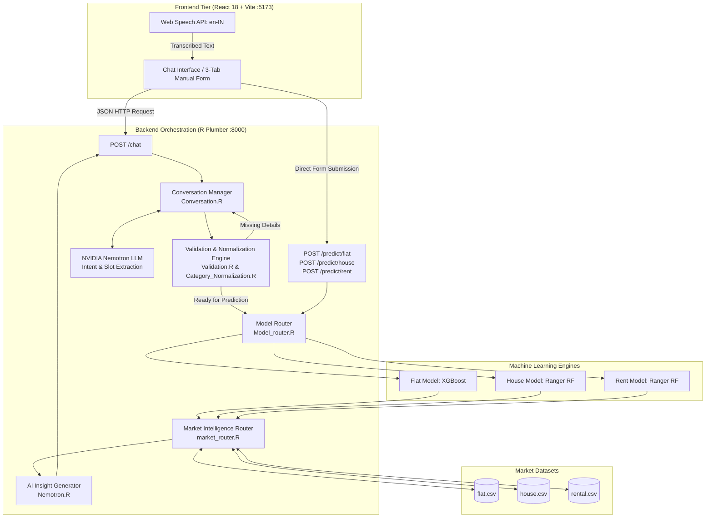

# 🏙️ PropGPT — Conversational AI Property Valuation & Market Intelligence

[](https://react.dev/)
[](https://tailwindcss.com/)
[](https://www.r-project.org/)
[](https://xgboost.readthedocs.io/)
[](https://cran.r-project.org/web/packages/ranger/index.html)
[](https://build.nvidia.com/)
[-F59E0B)](https://developer.mozilla.org/en-US/docs/Web/API/Web_Speech_API)
[](https://en.wikipedia.org/wiki/Hyderabad)

> **PropGPT** is a production-grade, AI-powered real estate price prediction and conversational property intelligence platform focused on **Hyderabad, Telangana, India**. It combines natural language understanding, browser-native speech recognition (`en-IN`), trained statistical and machine learning models, and real micro-market listing datasets into an integrated intelligent consultant.

---

## 🌟 Key Highlights

- 🗣️ **Conversational Property Intelligence**: Interact naturally via chat. PropGPT extracts intents and parameters across multiple turns, asking only for missing fields.
- 🎙️ **Native Voice Recognition**: Talk to PropGPT using browser-native Web Speech API configured for Indian English (`en-IN`) with interim live transcription.
- 🤖 **3 Specialized ML Predictors**:
  - **Flat Purchase Price**: XGBoost model with exact 10-feature matrix representation and target encoding.
  - **Independent House / Villa Price**: Ranger random forest regression with locality and floor-level features.
  - **Residential Rental Price**: Ranger random forest regression predicting monthly rentals across Hyderabad localities.
- 📊 **Real Micro-Market Intelligence**: Contextualizes numeric valuations with locality-level median rates, price distributions, and comparable active listings.
- 📝 **Deterministic 3-Tab Manual Form**: Includes a structured, direct model prediction form for users who prefer manual attribute inputs over chat.
- 🛡️ **Zero Price Hallucination**: Model valuations are computed strictly by trained backend algorithms; the LLM provides explanation and contextualization without fabricating numbers.

---

## 🏗️ System Architecture



---

## 🔄 Conversational Flow

PropGPT implements a **two-stage slot-filling dialog manager**:

1. **Stage 1 (Required Details)**:
   - Evaluates mandatory attributes: `intent` (`flat_purchase`, `house_purchase`, `rent`), `area`, `bhk`, and `locality`.
   - If missing, asks the user specifically for the missing details (e.g. *"How many bedrooms are you looking for, and approximately how large should the flat be?"*).
2. **Stage 2 (Optional Details)**:
   - Once all required fields are collected, asks **once** for supplementary details to refine the valuation:
     - `furnishing`: Unfurnished, Semi-Furnished, Furnished
     - `transaction`: Resale, New Property
     - `area_source`: Carpet, Super built-up
     - `bathroom`: 1, 2, 3, etc.
     - `balcony`: 0, 1, 2, etc.
   - Users can provide all details, partial details, or say *"skip"*. Defaults are safely applied.
3. **Stage 3 (Prediction & Market Synthesis)**:
   - Evaluates the trained ML model.
   - Retrieves locality aggregations and comparable listings from historical datasets.
   - Generates an authoritative response with an Indian Currency formatted card (Crores / Lakhs / Monthly Rent) and price per sq.ft.
4. **Follow-Up Inquiries**:
   - Updates modified parameters (e.g., *"What about in Miyapur?"* or *"What if it's 3 BHK?"*) while seamlessly preserving other established property attributes.

---

## 📊 Machine Learning Model Specifications

| Predictor | Algorithm | Target Variable | Key Inputs | Target Encoding |
|---|---|---|---|---|
| **Flat Purchase** | XGBoost | `log(Price)` | 10-Feature Matrix (`log_area`, `area_per_bhk`, `bhk`, `loc_encoded`, `Furnishing_ord`, `Transaction_ord`, `bhk_catencode`, `area_sourcesuper`, `Bathroom`, `Balcony`) | `loc_map` with `global_mean` fallback |
| **House Purchase** | Ranger RF | `log(Price)` | Area, BHK, Locality, Furnishing, Facing, Floor, Total Floors, Ownership, Bathrooms, Balconies | `loc_map_house` with `global_mean3` fallback |
| **Rental Price** | Ranger RF | `log(Rent)` | Area, BHK, Locality, Furnishing, Area Source, Bathrooms, Balconies, Floor, Total Floors | `loc_map4` with `global_mean4` fallback |

---

## 🔌 API Endpoints

The R Plumber backend serves the following REST endpoints on `http://127.0.0.1:8000`:

| Endpoint | Method | Description |
|---|---|---|
| `/health` | `GET` | Health check returning service status (`status: "ok"`) |
| `/chat` | `POST` | Conversational orchestrator handling slot-filling, prediction, and explanations |
| `/predict/flat` | `POST` | Direct XGBoost valuation for residential flats |
| `/predict/house` | `POST` | Direct Ranger valuation for independent houses and villas |
| `/predict/rent` | `POST` | Direct Ranger valuation for residential rentals |

### Sample Chat Request
```bash
curl -X POST http://127.0.0.1:8000/chat \
  -H "Content-Type: application/json" \
  -d '{
    "session_id": "session_sample_123",
    "message": "I want to buy a 2 BHK flat in Kukatpally around 1200 sqft"
  }'
```

---

## 📁 Repository Structure

```text
PropGPT/
├── Backend/
│   ├── Datasets/                      # Hyderabad market listing CSV datasets
│   │   ├── flat.csv
│   │   ├── house.csv
│   │   └── rental.csv
│   ├── models/                        # Pre-trained .rds model objects and encoding maps
│   │   ├── rf_model3.rds              # House prediction model
│   │   ├── rf_model4.rds              # Rental prediction model
│   │   └── loc_map*.rds               # Locality target encoding maps
│   ├── Predictors/                    # Prediction execution scripts
│   │   ├── Prediction.R               # Flat XGBoost predictor (pred_price_flat)
│   │   ├── predhouse.R                # House Ranger predictor (pred_house)
│   │   └── pred_rent.R                # Rent Ranger predictor (pred_rent)
│   ├── market_intelligence/           # Market comparison modules
│   │   ├── flat_intelligence.R
│   │   ├── house_intelligence.R
│   │   └── rent_intelligence.R
│   ├── API.R                          # OpenAPI specification and server starter
│   ├── Plumber.R                      # Primary Plumber API router & endpoints
│   ├── Conversation.R                 # Multi-turn state manager & dialog flow
│   ├── Nemotron.R                     # NVIDIA Nemotron LLM integration client
│   ├── Prompts.R                      # System instructions & slot extraction prompts
│   ├── Extraction.R                   # JSON response parser & data sanitization
│   ├── Validation.R                   # Numerical & categorical validation engine
│   ├── Category_Normalization.R       # Fuzzy categorical mapper
│   ├── Model_router.R                 # Dispatcher routing inputs to ML predictors
│   ├── market_router.R                # Unified market intelligence aggregator
│   └── .Renviron.example              # Environment configuration template
│
├── frontend/
│   ├── src/
│   │   ├── components/
│   │   │   ├── chat/                  # Conversational drawer, speech input, result card
│   │   │   │   ├── ChatInterface.jsx
│   │   │   │   ├── ChatInput.jsx      # Web Speech API (en-IN) voice input
│   │   │   │   ├── MessageBubble.jsx
│   │   │   │   └── PredictionCard.jsx # INR formatted result card
│   │   │   ├── manual-form/           # 3-Tab manual valuation form
│   │   │   │   ├── ManualPredictionForm.jsx
│   │   │   │   ├── FlatForm.jsx
│   │   │   │   ├── HouseForm.jsx
│   │   │   │   └── RentForm.jsx
│   │   │   ├── hero/                  # Skyline video hero & starter prompts
│   │   │   ├── sections/              # How it works & market trends
│   │   │   └── common/                # Navbar, Footer, Form controls
│   │   ├── services/
│   │   │   └── plumberApi.js          # API client for backend communication
│   │   ├── utils/
│   │   │   └── formatters.js          # INR Lakh/Crore and price/sqft formatters
│   │   └── constants/
│   │       └── localities.js          # Curated list of Hyderabad localities
│   ├── package.json
│   └── vite.config.js
│
├── .gitignore                         # Project-wide ignore rules
└── README.md
```

---

## 🚀 Quick Start Guide

### Prerequisites
- **R (>= 4.2)**: With packages `plumber`, `xgboost`, `ranger`, `dplyr`, `stringr`, `jsonlite`.
- **Node.js (>= 18)**: For Vite + React.
- **NVIDIA API Key**: Free tier available from [NVIDIA Build](https://build.nvidia.com/).

---

### 1. Backend Setup

1. Open a terminal in the `Backend/` directory:
   ```bash
   cd Backend
   ```

2. Configure your NVIDIA Nemotron API key:
   ```bash
   cp .Renviron.example .Renviron
   ```
   Edit `.Renviron` and paste your key:
   ```env
   NVIDIA_API_KEY="nvapi-your-key-here"
   ```

3. Install required R packages (if not already installed):
   ```R
   install.packages(c("plumber", "xgboost", "ranger", "dplyr", "stringr", "jsonlite"))
   ```

4. Launch the Plumber API server:
   ```bash
   Rscript API.R
   ```
   The backend API will start on `http://127.0.0.1:8000`. Swagger documentation is available at `http://127.0.0.1:8000/__docs__/`.

---

### 2. Frontend Setup

1. Open a separate terminal in the `frontend/` directory:
   ```bash
   cd frontend
   ```

2. Install dependencies:
   ```bash
   npm install
   ```

3. Start the Vite development server:
   ```bash
   npm run dev
   ```

4. Open your browser and navigate to:
   ```text
   http://127.0.0.1:5173/
   ```

---

## 🎙️ Voice Input Instructions

1. Ensure you are using a browser supporting the Web Speech API (Google Chrome, Microsoft Edge, Brave, or Safari).
2. Click the **Microphone icon** in the chat input.
3. Allow microphone permission when prompted by your browser.
4. Speak naturally in English (e.g., *"I am looking for a 3 BHK flat in Gachibowli around 1600 square feet"*).
5. Watch the real-time interim transcription appear in the input box.
6. Review or edit the text, then click **Send** to start the valuation.

---

## 🧪 Testing

Run the automated simulation test suites from the `Backend/` directory:

```bash
# Test multi-turn conversational workflow & follow-up locality changes
Rscript test_e2e_simulation.R

# Test House and Rent conversational prediction pipelines
Rscript test_house_rent_e2e.R
```

---

## ⚖️ Disclaimer

*PropGPT provides machine-learning-based property estimates and market context for informational purposes only. Predictions are generated from trained statistical regression models and historical listings; they do not constitute legally binding appraisal certificates, financial advice, or guaranteed transaction quotes. Actual transaction prices may vary based on specific property conditions, builder reputations, exact floor positioning, amenities, and negotiations.*

---

## 👤 Author

**Karan Mantri**  
GitHub: [@KaranMantrii](https://github.com/KaranMantrii)
