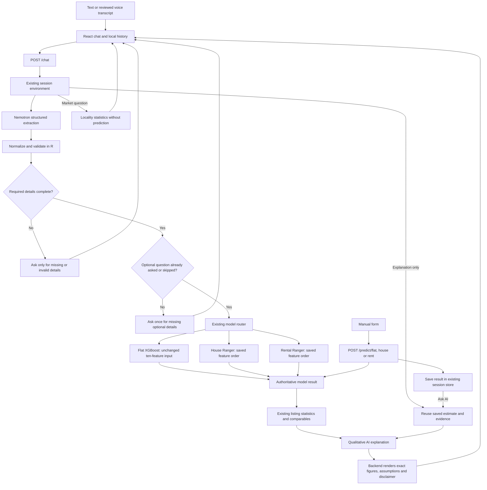

# PropGPT integration audit

## Existing architecture

`main.jsx` mounts `App` inside an error boundary. `App` selects a browser-local
chat from `chatStorage`, renders `Sidebar`, `ChatInterface`, the manual predictor,
and settings. The current layout uses plain CSS and inline styles; Tailwind is
not installed. Keep that styling rather than replacing it.

Chat input -> `plumberApi.sendChatMessage` -> `POST /chat` in `Plumber.R` ->
`process_conversation` in `Conversation.R` -> `build_extraction_messages` ->
`nemotron_chat` -> `Extraction.R` -> merge session property -> `Validation.R`
(including category normalization and square-yard conversion) -> required-field
question -> one optional-field question -> `Model_router.R` -> selected predictor
-> `market_router.R` -> existing listing statistics/comparables -> Nemotron
explanation -> structured API response -> message and prediction card.

Manual form -> one of the three `/predict/*` endpoints -> corresponding predictor.
All predictors require area, BHK, locality; the router additionally requires intent.
House/rent model defaults include floor 3 of 5, Carpet area, bathrooms equal to BHK,
one balcony, Semi-Furnished; house also defaults to Resale, Freehold, East.
Flat has the same furnishing/bathroom/balcony/area defaults and Resale transaction.

`Prediction.R` loads the saved `.RData` workspace. House and rent use the objects
in that workspace. Flat builds its exact ten-feature matrix; house/rent align
features against saved `pred_vars3` / `pred_vars4`. No model changes or retraining
are needed. Datasets are loaded once by the market router. Statistics describe
advertised listings, not verified sale deeds or current market trends.

Browser history persists locally; backend conversation state is held in the
existing `PROPGPT_SESSIONS` environment keyed by session ID. Backend restart loses
server context. No authentication or persistent multi-user session store exists.

## Gaps identified before implementation

- Default Plumber JSON serializer wraps scalars in arrays; UI string methods fail.
- Manual form fabricates a price after a failed backend call.
- Manual-to-chat callback creates an unused message and never sends it.
- Frontend settings URL/speech preferences are disconnected from their consumers.
- Explanatory follow-ups rerun a model; previous prediction is not retained.
- General market questions are treated as incomplete valuation requests.
- Optional questions can come from LLM text instead of backend missing-field rules;
  house extras are listed as missing but never actually asked.
- Numeric extraction can drop invalid corrections and reuse an earlier valid value.
- Direct house/rent endpoints do not share conversational category validation.
- Missing market data can prevent the whole backend from starting.
- Speech callbacks can duplicate results or restore text after Send/unmount.
- Active UI contains unsupported confidence, live registry and certification claims.
- Existing simulation scripts print results without assertions and bypass HTTP/UI.

## Final system and workflow



1. A starter prompt uses the current chat. New Chat creates a separate browser and
   backend session. A synchronous submission guard prevents duplicate sends.
2. The backend decides readiness; model-generated readiness flags are not trusted.
   Area, bedrooms and locality are required for each actual predictor, plus intent
   for routing. Categories stay readable until the existing predictors encode them.
3. Required fields are validated before optional questions. House-specific fields
   are actually asked; rentals do not ask purchase transaction type. Supplied
   optional values are retained. Partial answers or skipping use original defaults.
4. Defaults are resolved in the router, not invented by the LLM, and disclosed in
   the response. Ground floor is valid. Counts must be whole numbers, total floors
   positive, and property floor cannot exceed total floors when both are supplied.
5. Only the chosen predictor runs. The original predictors and all saved model
   objects are unchanged. Regression checks compare routed defaults with direct
   calls to the original functions and obtain identical formatted outputs.
6. Market context uses the same effective area basis as inference. Broader-locality
   matches are disclosed. General locality comparisons reuse dataset statistics
   without requesting a property area or running a model; their BHK/area scope is
   stated. There is no time-series evidence supporting live appreciation claims.
7. Explanations reuse a saved result and its original input snapshot. Property
   modifications are revalidated and produce a fresh result. Explicit new-property
   requests reset property and optional-field state. Failed predictions return no
   new price, and a previous result remains clearly identified as previous.
8. The backend supplies every displayed numerical summary from model/dataset
   values. AI prose containing numerical figures is replaced by a qualitative
   fallback. The result card remains authoritative. A failed explanatory AI call
   still permits the backend's factual estimate and listing summary to render.

## Voice input

The microphone creates a browser-native recognition session using Indian English
by default, `continuous=false`, interim results, and three alternatives. Results
are rebuilt from the browser's complete result list so repeated final results do
not duplicate text. Existing typed text is retained. Interim text is visible while
listening; final text remains editable. Only clicking Send or pressing Enter sends
the draft. Editing, sending, or unmounting disposes the recognition callbacks so
late speech events cannot restore cleared text. Unsupported browsers, missing
audio, denied permission, empty recognition and network errors have readable
messages. Language preferences are read when starting recognition.

## Session state

The browser stores titled conversations and a current ID in localStorage. A
separate backend session ID can be retained for manual-result discussions. The
existing `PROPGPT_SESSIONS` environment holds history, property values, optional
question status, stage, timestamps, last successful prediction with its original
property snapshot, and last market context. Responses expose collection/readiness
and prediction status. Clearing a chat rotates its backend ID; deleting a chat
cannot be undone by a late in-flight response. No parallel conversation system or
new prediction endpoints were introduced.

## API examples

Requests are JSON; scalar response fields are scalars. The frontend also accepts
older Plumber responses that wrap scalar values in singleton arrays. Lists such
as suggestions, missing fields and comparable rows remain lists.

```http
POST /chat
Content-Type: application/json

{"session_id":"example_flat","message":"I want to buy a flat in Kukatpally"}
```

Relevant response fields (the property object contains additional state):

```json
{
  "session_id": "example_flat",
  "reply": "Sure! How many bedrooms (BHK) are you looking for, and approximately how large should the property be (in sq ft)?",
  "prediction": null,
  "prediction_success": false,
  "missing_fields": ["area", "bhk"],
  "ready_for_prediction": false
}
```

Next messages can supply `2 BHK, 1200 sqft`, followed by `skip` or optional details.

```http
POST /predict/flat
Content-Type: application/json

{"session_id":"manual_example","query_area":1200,"query_bhk":2,"query_locality":"Kukatpally","query_Furnishing":"Semi-Furnished","query_Transaction":"Resale","query_area_source":"Super","query_Bathroom":2,"query_Balcony":0}
```

Verified example:

```json
{"success":true,"prediction_type":"flat_price","session_id":"manual_example","predicted_price":"88.36 Lac","currency":"INR"}
```

The optional `session_id` saves that manual result. Sending `/chat` with that same
ID and `Please explain the previous manual valuation without changing details`
reuses it, with no second model execution. House/rent accept lower-case field
variants (`query_furnishing`, `query_bathroom`, `query_balcony`) and floor inputs;
house additionally accepts transaction, ownership and facing. Existing public
request names and formatted predictor results remain compatible.

Validation errors return HTTP 400. Unavailable/malformed extraction responses
return HTTP 503 with a safe explanation and no estimate. Model errors return no
fabricated price. Detailed diagnostic messages remain in backend logs.

## Changes made during integration

Existing uncommitted design changes were preserved. Files changed for this work:

| File(s) | Purpose |
|---|---|
| `.gitignore` | Ignore project-local R dependencies; existing secret exclusions retained |
| `Backend/API.R`, `Backend/Dockerfile` | Project libraries, UTF-8, scalar JSON, configurable host; localhost for development and container binding for Docker |
| `Backend/.Renviron.example`, `frontend/.env.example` | Document server-only NVIDIA configuration, origins, host/port and public frontend API URL |
| `Backend/Plumber.R` | Shared direct-request validation, restricted configured CORS, safe errors, optional manual-result session retention |
| `Backend/Conversation.R` | Backend-controlled questions, session/result reuse, market questions, explicit new-property reset, safe extraction failures |
| `Backend/Extraction.R` | Recognize action/localities and retain invalid numeric corrections for rejection |
| `Backend/Validation.R` | Scalar input shapes, whole counts, ground floor, ownership/facing normalization |
| `Backend/Model_router.R` | Resolve/disclose original predictor defaults without changing feature engineering |
| `Backend/Nemotron.R`, `Backend/Prompts.R` | Environment-based model/base URL, structured extraction, constrained explanations, deterministic numerical summaries |
| `Backend/market_router.R` | A missing dataset no longer prevents all prediction services from starting |
| `frontend/src/App.jsx`, `frontend/src/App.css` | Working manual-to-chat handoff, shared session ID, refreshing connection status and mobile header/form/composer fixes |
| `frontend/src/services/chatStorage.js` | Nonrecursive initialization, final-session deletion, safe late-response handling and backend ID storage |
| `frontend/src/services/plumberApi.js` | Scalar compatibility, usable configured endpoint, timeouts, readable failures, manual session IDs |
| `frontend/src/services/speechRecognition.js` | Native speech lifecycle and duplicate-safe transcript assembly |
| `frontend/src/components/chat/ChatInput.jsx`, `ChatInterface.jsx` | Speech integration, single-send guard, safe clearing and manual prompt consumption |
| `frontend/src/components/chat/MessageBubble.jsx` | Safe rendering of older nonstring message content |
| `frontend/src/components/chat/ChatHomeEmptyState.jsx`, `PredictionCard.jsx` | Remove unsupported active-screen statistics/confidence claims, show proper result type and ground floor |
| `frontend/src/components/manual-form/ManualPredictionForm.jsx`, `PredictionResultPanel.jsx` | Remove fabricated fallback, support real result handoff, show only applicable inputs and disclaimer |
| `frontend/src/components/settings/SettingsModal.jsx`, `frontend/src/utils/formatters.js` | Test edited backend URL and honor currency/speech settings |
| `frontend/package.json`, `frontend/test/*`, `Backend/test_workflow.R` | Repeatable frontend, speech, backend and HTTP/live-AI regression suites |
| `docs/INTEGRATION.md`, `docs/integration-results.json`, `README.md` | Architecture, changes, examples and actual verification record |

## Verification and practical limits

- `Rscript test_workflow.R`: **39 checks passed**, using real saved models and
  datasets with controlled extraction/AI responses. Covers required and optional
  fields, corrections, skipping, model routing, defaults, ground floor, invalid
  values, session isolation, market absence, malformed JSON, AI/model failures,
  numerical-prose rejection and manual-result reuse.
- `npm test`: **5 grouped tests passed**, covering storage lifecycle/late responses,
  legacy API shapes, failed requests, zero balconies and mocked speech lifecycles.
- `npm run build`: passed. `npm run lint`: exits successfully with existing unused
  imports/catch-variable and sidebar render-time warnings; no lint errors.
- `node test/integration.mjs`: **16 HTTP/live-NVIDIA checks passed** on October 26,
  2026. This uses the frontend's actual service client against the running API:
  health, all three saved models, validation failures, manual-estimate reuse,
  missing/accumulated required details, partial optional answers, locality update,
  explanation, scoped market comparison, complete house/rent requests and separate
  sessions. Full synthetic request results are saved in `integration-results.json`.
- Browser verification: chat submitted a complete property request and rendered a
  result card; manual flat valuation rendered ₹1.77 Cr for the form's default
  Kokapet example; Ask AI created exactly one discussion with one outgoing message.
  Mobile navigation and the manual prediction form were inspected at 390 × 844;
  overflowing chat header and tab controls were fixed and visually rechecked.
  The viewport override was temporary and is reset after inspection.
- Git comparison confirms no edits to `Backend/Predictors`, `Backend/models`, or
  `Backend/.RData`. The NVIDIA key is present only in the ignored backend environment
  file; it is not included in this report, source control, or frontend settings.

Real microphone/audio recognition and OS permission dialogs have **not** been
tested. Speech tests simulate browser recognition events; actual browser support
and microphone permissions still need a person with an audio device.

Sessions are memory-only on the R server and reset on restart. Browser history
persists independently and cannot restore a lost backend state by itself. The API
uses opaque IDs but has no authentication/authorization layer; it is a local
development service, not a hardened multi-tenant deployment. Production requires
authenticated session ownership, persistence, lifecycle limits, and configured
origins/HTTPS. Synchronous NVIDIA requests can occupy the R worker and delay other
requests, including health checks. Multi-worker asynchronous orchestration is a
separate deployment change, not silently introduced here.

Market datasets do not establish live prices, verified deeds or time trends.
Unknown model localities retain the original global-mean fallback, and missing
local statistics are explicitly identified. There are no calibrated confidence
intervals. Document analysis is unavailable; the attachment control explains that
limitation instead of pretending to upload a file. Legacy landing-page components
remain unmounted; their static example marketing panels are not used as market
evidence in the active product.

## Run locally

Use Node `^20.19.0` or `>=22.12.0`, as required by the installed Vite version.
From `frontend/`, run `npm install`, then `npm run dev`.
From `Backend/`, run `Rscript API.R` with required R packages installed. This
machine's R executable is `C:/Program Files/R/R-4.6.1/bin/Rscript.exe`.
The backend prefers `../.r-library` when present. NVIDIA credentials belong in
`Backend/.Renviron`; copy the example only when setting up a new environment,
without overwriting an existing key. Never put secrets in `VITE_*` variables.

Frontend: `http://127.0.0.1:5173/`. Backend: `http://127.0.0.1:8000/health`.
Run live checks from `frontend/` with `node test/integration.mjs` while both
services are running. These use synthetic property requests and the configured
NVIDIA connection. The deterministic suite does not require an external AI call.
